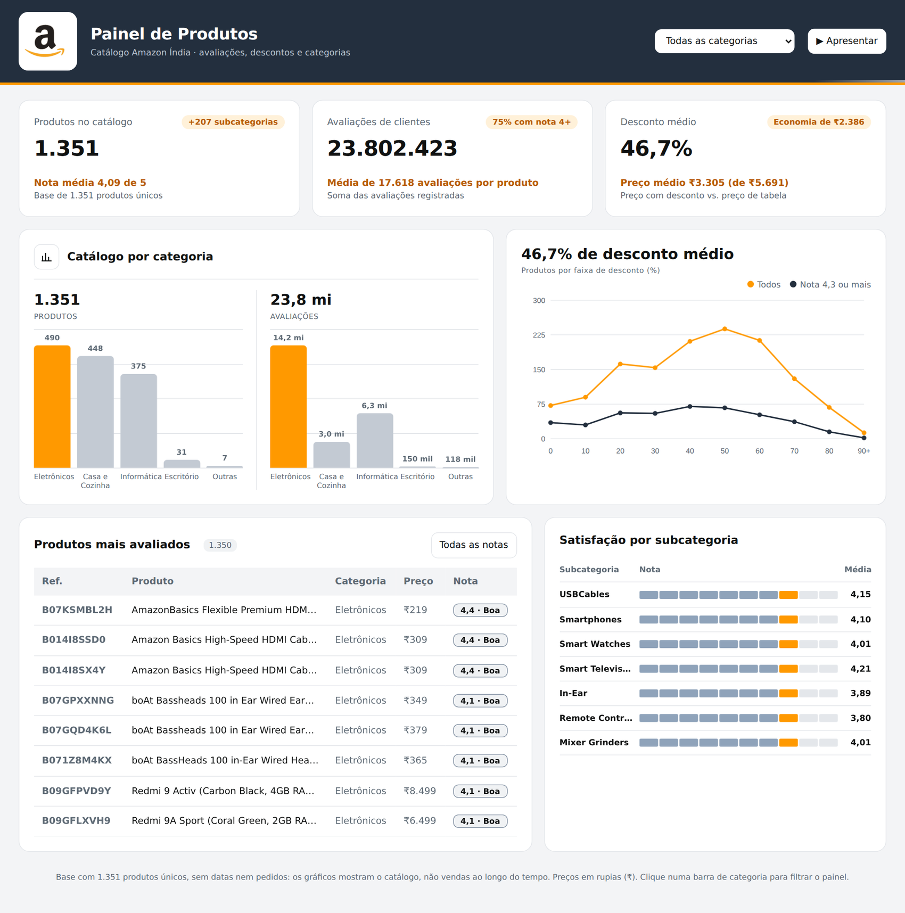
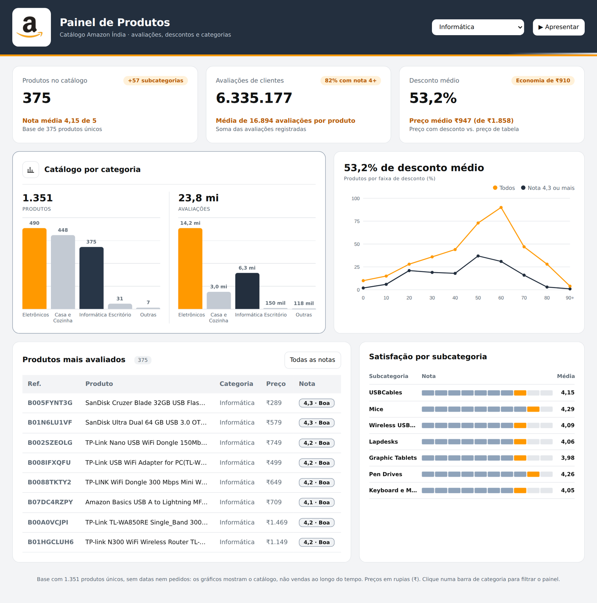
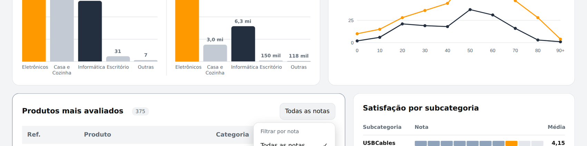
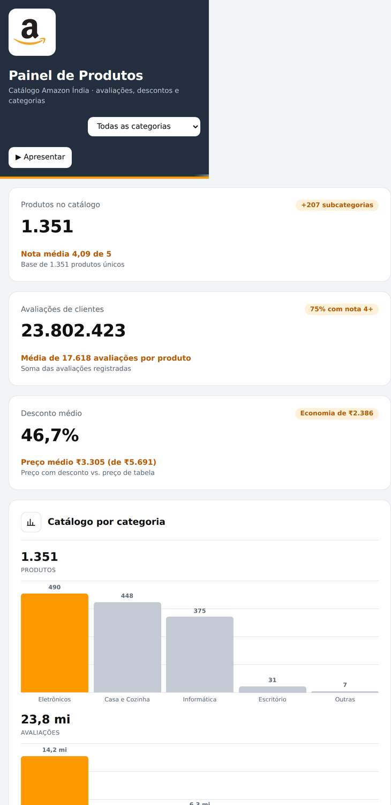

# Painel de Produtos Amazon

Dashboard interativo de BI feito em HTML, CSS e JavaScript puros, a partir de um catálogo de produtos da Amazon Índia. O visual segue a identidade da marca (azul-marinho e laranja) e o logo é usado como banner.

## Capturas de tela

### Visão geral



### Filtro por categoria

Clicar em uma barra de categoria (ou usar o seletor no topo) recalcula todos os indicadores, o gráfico de descontos, a tabela e a satisfação por subcategoria.



### Filtro por faixa de nota



### Modo escuro

O painel acompanha automaticamente o tema do dispositivo.


### Versão para celular



## O que o painel mostra

- **Indicadores principais:** total de produtos únicos, total de avaliações de clientes e desconto médio, com a economia média em rupias.
- **Catálogo por categoria:** gráficos de barras com a quantidade de produtos e o volume de avaliações em cada categoria principal.
- **Faixas de desconto:** gráfico de linhas comparando todos os produtos com os de nota 4,3 ou mais.
- **Produtos mais avaliados:** tabela com filtro por faixa de nota (excelente, boa e regular).
- **Satisfação por subcategoria:** nota média das subcategorias com mais produtos.

## Interatividade e animação

- Filtro por categoria no topo da página e por clique nas barras do gráfico (clicar de novo limpa o filtro).
- Modo apresentação, que percorre as categorias automaticamente.
- Contagem animada nos indicadores, barras que crescem, linha desenhada progressivamente e entrada escalonada das tabelas.
- Respeita a preferência de sistema "reduzir movimento" e acompanha o modo claro ou escuro do dispositivo.

## Dados

O arquivo `data/amazon.csv` contém 1.465 linhas, que correspondem a 1.351 produtos únicos após a remoção de duplicados. As colunas usadas são categoria, preço com desconto, preço de tabela, percentual de desconto, nota e quantidade de avaliações. Os preços estão em rupias indianas.

O conjunto de dados é um catálogo: não tem datas nem pedidos. Por isso o painel analisa o catálogo (preços, descontos e avaliações) e não vendas ao longo do tempo.

## Tratamento dos dados

- Remoção de duplicados pelo identificador do produto.
- Conversão de preços e percentuais de texto (por exemplo, "₹1,099" e "64%") para número.
- Tratamento de valores ausentes ou inválidos em nota e quantidade de avaliações.
- Agrupamento das categorias menores em "Outras".

Os dados tratados são embutidos diretamente no `index.html`, então a página funciona sem servidor e sem dependências.

## Como executar

Abra o arquivo `index.html` em qualquer navegador moderno. Não há instalação nem etapa de build.

## Tecnologias

HTML5, CSS3 (variáveis, grid, animações com keyframes) e JavaScript sem bibliotecas. Os gráficos são desenhados com SVG e CSS. A fonte Inter é carregada do Google Fonts, com fontes do sistema como alternativa.

## Estrutura

```
.
├── index.html        # painel completo (dados e logo embutidos)
├── docs/             # capturas de tela usadas no README
├── data/
│   └── amazon.csv    # dados originais
└── README.md
```

## Créditos

Dados: base pública de produtos da Amazon Índia (arquivo `amazon.csv`). O logo e a marca Amazon pertencem aos seus titulares e são usados aqui apenas para fins educacionais e de portfólio.
